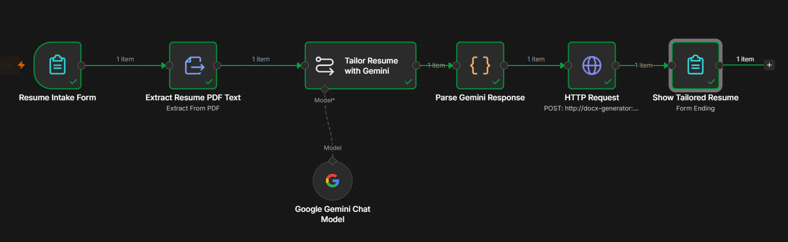

# Resume Tailor (n8n + Gemini)

A portable, local-first n8n project for tailoring an existing resume to a specific job description.

> **Project status: scaffold / not yet functional end-to-end.** This repository currently contains the cross-platform Docker setup and project documentation. The adapted n8n workflow will be added after its input, document parsing, AI output, and file export steps have been tested.

## Goals

- Run locally on Windows, macOS, or Linux using Docker Compose.
- Accept an uploaded resume and pasted job description.
- Use Gemini initially, with provider configuration kept easy to change later.
- Generate a tailored, editable resume and a concise change report.
- Avoid dependencies on Google Drive, Notion, or other cloud document storage.
- Keep secrets, uploaded resumes, and generated documents out of Git.

## Screenshots




## Requirements

- Docker Desktop (Windows/macOS) or Docker Engine + the Compose plugin (Linux)
- A web browser
- A Gemini API key from Google AI Studio

## Quick start

1. Install Docker for your operating system:
   - Windows/macOS: <https://docs.docker.com/get-started/get-docker/>
   - Linux: <https://docs.docker.com/engine/install/>
2. Copy `.env.example` to `.env`.
3. Generate a long random encryption key and put it in `.env` as `N8N_ENCRYPTION_KEY`.
   - Linux/macOS: `openssl rand -hex 32`
   - Windows PowerShell (if OpenSSL is unavailable): `-join ((1..64) | ForEach-Object { '{0:x}' -f (Get-Random -Maximum 16) })`
4. From this repository folder, run:

   ```bash
   docker compose up -d
   ```

5. Open <http://localhost:5678> and complete the initial n8n owner-account setup.
6. To stop n8n:

   ```bash
   docker compose down
   ```

The named Docker volume `n8n_data` preserves n8n's local configuration when the container is stopped and recreated. **Do not run `docker compose down -v` unless you intend to delete that volume and its data.**

## Gemini credentials

The workflow will use a Gemini API credential configured inside n8n. Add the key through the n8n credentials UI when the workflow is ready. Do not put real API keys in this repository, screenshots, exported workflow JSON, or commits.

Google AI Studio: <https://aistudio.google.com/>

Free-tier model availability and quotas can change. Check the current terms and limits for the model you choose.

## Current status and next steps

See [`docs/WORKFLOW_PLAN.md`](docs/WORKFLOW_PLAN.md) for the intended workflow and implementation checklist.

The starter does **not** yet include a working resume-processing workflow. We will adapt the existing n8n community template where useful, while removing its Notion, Google Drive, and Firecrawl dependencies. The final workflow will be exported to `workflows/` and tested before this README is labelled complete.

## Cross-platform notes

- Use `docker compose` (with a space), not the older standalone `docker-compose`, where supported.
- Open n8n through `http://localhost:5678` on the same computer.
- Keep `.env` local; commit only `.env.example`.
- Resume uploads and generated files may contain sensitive personal data. Use dummy data while testing and review the workflow's retention behaviour before using real resumes.
- This project is designed for local use. Do not expose port `5678` directly to the public internet without an intentional security and deployment plan.

## Troubleshooting

- **Port 5678 is already in use:** change the left side of the port mapping in `compose.yaml`, e.g. `"5679:5678"`, then visit `http://localhost:5679`.
- **Container is not running:** run `docker compose ps` and `docker compose logs n8n`.
- **Need to restart:** run `docker compose restart n8n`.
- **Need a clean stop:** run `docker compose down`. This preserves the named volume.

## License

MIT. See [`LICENSE`](LICENSE).
